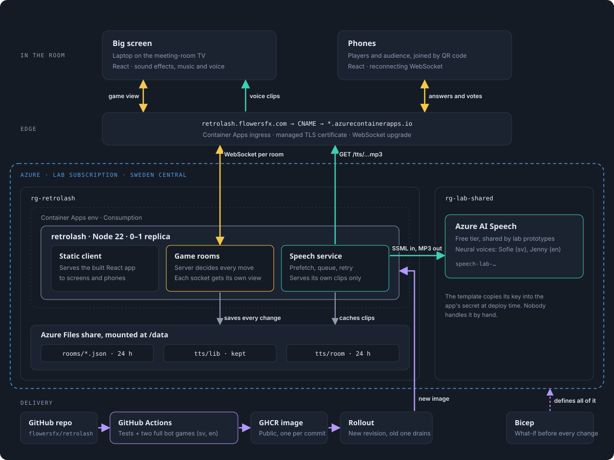

# Retrolash

A Quiplash-style party game for Scrum retrospectives. The meeting-room screen hosts the game; everyone plays on their phone by scanning a QR code. No accounts, no app install.

## How a game runs

1. **Lobby.** The host opens the site on the big screen and clicks *Host a retro*. Players scan the QR code (or enter the 4-letter room code) and type a name. You need at least 3 players. The lobby shows tonight's line-up of rounds.
2. **Check-in.** Everyone picks a sprint "weather" (☀️ to ⛈️) on their phone. The big screen shows the spread, never who picked what.
3. **Did we do it?** Only when you paste last retro's action items in the lobby settings. Everyone marks each item ✅ done, 🟡 partly or ❌ not done.
4. **Warm-up.** A pure-fun icebreaker. Each player gets two silly prompts. Every prompt goes to two players, and their answers go head-to-head on the big screen while everyone else votes.
5. **Emoji Only.** Same format, but answers are emoji only.
6. **The Sprint.** Head-to-head with retro prompts ("The thing that slowed us down the most", "If this sprint was a movie…"). It's played over at least two rounds (three with only three players), and later rounds score more. After each matchup there's a discussion pause with a talking point and a 60-second timer. Pick a **Sprint format** in the lobby to use prompts after a classic retro format: Start · Stop · Continue, 4Ls, Sailboat, or Mad · Sad · Glad.
7. **Kudos.** Everyone writes an anonymous shout-out to a teammate (or the whole team). The notes land on the big screen one by one.
8. **Last Lash: Action Items.** Everyone answers the same prompt (default: *"One concrete thing we should change next sprint"*), with up to 2 ideas each, then gets 3 votes. On the results screen people tap **I'll take it** on their phone to own an item.
9. **Highlights and podium.** The three best answers of the game come back one by one. Then third place, second place, a drumroll and the winner with a crown and confetti (equal scores share a place). The podium is skipped in Anonymous mode.
10. **Summary.** Action items with owners, the sprint weather, the follow-up results, kudos, every sprint answer with its votes, and the scores. *Copy as Markdown* pastes into Confluence, Jira or Slack; *Download .md* saves it. Next time, paste that Markdown into the lobby to run *Did we do it?*.

Everything up to the Last Lash results moves on by itself on timers, so the game keeps going even if the facilitator gets pulled into the discussion. The Last Lash results and the summary wait for the facilitator.

The whole game (screens, phones, prompts and the Markdown export) is available in **English and Swedish**; switch in the lobby.

As in Quiplash, answers are anonymous while people vote. After the vote, the screen shows who wrote what, and the voters' avatars fly onto the answer they picked. You can switch on **Anonymous mode** in the lobby to hide authors, voters and scores entirely. Owners of action items are always shown, because volunteering is a deliberate choice.

### Audience

Someone dropping in mid-retro (a PO, a manager) can tap **Join as audience** on their phone. The audience votes in the head-to-heads and the Last Lash, reacts, and can volunteer to own an action item, but doesn't write answers, score, or take part in the check-in. When all players have voted, the audience gets a few more seconds before the vote closes. Up to 40 audience members; full players are capped at 16.

### On the big screen

- Each matchup opens with its number slamming in and the prompt typing out while a fuse burns down. Then the cards fly in.
- On the reveal, the voters' coloured name plates fly onto the answer they picked, one by one. Then the scores count up. Cards leave the screen with one of five random exits.
- A clean sweep is a **RETROLASH**: the losing card gets knocked out, and the winner takes centre stage with confetti.
- Win streaks ("Hat trick!"), comebacks from last place and lead changes get called out.
- The Last Lash results reveal from the bottom up with a drumroll.
- A small QR code in the header lets latecomers join mid-game.
- **Spoken prompts:** the voice announces each round ("Round 3. The Sprint!"), reads the prompts and names the winner on the podium. With Azure AI Speech set up (see [infra/README.md](infra/README.md)), the big screen reads round titles and prompts aloud in English or Swedish, and the intros stretch to fit. Toggle it in the lobby; the 🎵 panel has a voice volume. Without Speech the game simply runs silent.
- Sound effects and a background music loop are generated in the browser. 🔊 mutes everything; 🎵 opens music on/off and separate volume sliders for music and sound effects (remembered in the browser). Browsers only allow sound after the first click or key press on the page.
- Players can tap emoji reactions on their phone while they wait. The reactions float up on the big screen.
- A 🆘 *Help me* button on the phone fills in a ready-made silly answer when someone is stuck. If a player runs out of time, the game answers for them the same way, so no matchup is a walkover. An auto-answer is marked on the card after the vote and earns half points.

### Facilitator controls (big screen)

- The browser that opens a room first becomes its big screen and keeps a secret for it. Another browser opening `/?host=<code>` is turned away, so players who see the room code can't take over. On another laptop, start a new room, or make someone VIP to run the game from a phone.

- **Space**, **→** or **Page Down** advances or skips the timer, presenter-clicker style.
- **P** holds the timer (for a longer discussion) and resumes it.
- In the lobby you can pick rounds, the number of Sprint rounds, the discussion time (or *Wait for me* to advance by hand), timers and the final-round prompt. You can also add **your own retro prompts**, one per line, which are used first in *The Sprint*, and paste **last retro's action items**.
- Hover over a player in the lobby to remove them. Audience members can be removed at any time.
- Click 🎛️ on a player or audience member to make them **VIP**. Their phone becomes a remote control (Start, Next, Hold), so the facilitator can step away from the laptop.

### On the phones

- Players pick their avatar and name-plate colour when joining (and can change it in the lobby).
- After each matchup, the phone shows your own result: won or lost, the votes, the points.
- Closing the tab by mistake is fine: opening the link again offers **Continue as …**.

## Development

```bash
npm install
npm run dev
```

This starts the game server on `:1999` (`tsx watch server/main.ts`) and Vite on `:5173`. Vite listens on your LAN, so phones on the same Wi-Fi can join via `http://<your-ip>:5173`. The QR code points there automatically when you open the host page by IP instead of `localhost`. Saved games go to `./data/` (git-ignored).

To test without a pile of phones, fill a room with bots:

```bash
node scripts/bots.mjs ABCD 4                                  # local dev server
node scripts/bots.mjs ABCD 4 localhost:1999 1                 # plus 1 audience bot
BOT_VOTE=0 node scripts/bots.mjs ABCD 4 localhost:1999        # everyone votes left: forces RETROLASH
node scripts/bots.mjs ABCD 4 retrolash.<env>.swedencentral.azurecontainerapps.io   # deployed
```

`npm run typecheck` type-checks everything. `npm test` runs the helper self-tests and a full end-to-end bot game (`scripts/e2e.mjs`, fast timers via `TIME_SCALE`), which also runs in CI. `npm run build` builds the client to `dist/` and bundles the server to `dist-server/main.js`; `npm start` runs that build on `:1999` (or `$PORT`).

## Deploy (Azure Container Apps)

Live at **https://retrolash.flowersfx.com**. One container serves both the web app and the game server, on one URL. It scales to zero when nobody is playing, so the expected cost for a few retros a month is close to zero. See [infra/README.md](infra/README.md) for the full setup, costs and how GitHub Actions rolls out new versions.

Short version:

1. Push to `main`. GitHub Actions builds `ghcr.io/flowersfx/retrolash` and pushes it to GitHub's container registry.
2. Once: `./infra/deploy.ps1 -SubscriptionId <id>` creates the Azure resources (shows a what-if preview first).
3. Optional, once: `./infra/setup-github-oidc.ps1 -SubscriptionId <id>` lets every push to `main` roll out automatically.

## Architecture



See [docs/ARCHITECTURE.md](docs/ARCHITECTURE.md) for the decisions behind it.

```
server/game.ts      Authoritative game state machine (one GameRoom per game); transport-agnostic
server/main.ts      Node runtime: static files, WebSockets (/parties/main/<room>), file-backed state
shared/types.ts     Wire protocol + settings shared by server and client
shared/prompts.ts   Prompt library (English) + packs; prompts-sv.ts is Swedish
shared/i18n.ts      Screen texts in English and Swedish
src/Host.tsx        Big-screen view
src/Play.tsx        Phone controller
src/net.ts          PartySocket (reconnecting WebSocket) hook, countdown, room codes
scripts/bots.mjs    Bot players for testing
infra/              Bicep template + deploy scripts for Azure Container Apps
```

The server holds all state and sends each connection its own view. The host sees the matchup; a phone sees only its own prompts and ballots. State is saved to disk after every change (Azure Files in production), so a reload of the big screen or a phone, or a server restart, resumes where it was. Saved games are deleted after 24 hours. Phones keep their identity per browser tab, and remember the last one per room so a closed tab can rejoin as the same player.

The server runs as a single instance by design: rooms live in memory. That comfortably handles a handful of simultaneous retros.
