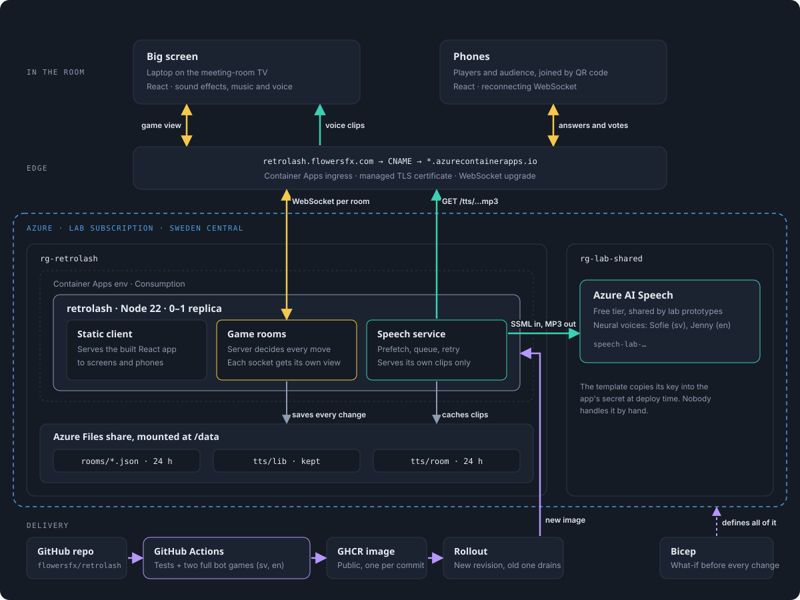

# Architecture

| Colour | Flow |
|---|---|
| Yellow | Game traffic: one WebSocket per room, both ways |
| Teal | Spoken prompts: synthesised by Azure AI Speech, cached, played on the big screen |
| Violet | Delivery: tests, image, rollout |
| Grey | Writes to the file share |

## Decisions

**One process, one replica.** Rooms live in memory in a single Node process (`server/main.ts`). `server/game.ts` decides every state change and sends each connection only what it may see (`HostView` for the big screen, `PlayerView` for a phone), so phones can't peek at votes. The app is capped at one replica on purpose.

**Scales to zero.** Azure Container Apps (Consumption) runs no replica while nobody is playing, so the cost is close to nothing. The first visit after a quiet spell takes about 40 seconds, so the big screen should open a minute before the retro.

**Survives restarts.** Every change is written to the Azure Files share mounted at `/data`, so a redeploy or a crash resumes mid-game. Saved games are deleted after 24 hours, because retro answers can be sensitive.

**Speech never blocks the game.** `server/tts.ts` synthesises prompts while people write their answers and caches them by a hash of voice and text. Built-in lines are kept for good; custom prompts are deleted with the saved games. If a clip isn't ready when an intro starts, that intro runs silent and on time. Clients can only download clips the server made.

**No secrets by hand.** The storage key and the Speech key go from the Bicep templates (`listKeys()`) straight into app secrets. Nothing is pasted into a terminal, the repo or GitHub.

**Shared lab Speech.** The Azure AI Speech account lives in its own resource group (`rg-lab-shared`, `infra/lab/`) so other prototypes in the subscription can use it. Its free-tier quota and rate limits are shared, and rotating its key affects every app that uses it.

**Tested end to end.** Every push runs type checks, unit tests and two complete bot games, in Swedish and English, before an image is published to GHCR (`.github/workflows/deploy.yml`, `scripts/e2e.mjs`).

## Where things are

| Piece | Where |
|---|---|
| Big screen and phones | `src/Host.tsx`, `src/Play.tsx` |
| Game state machine | `server/game.ts` |
| Runtime: static files, WebSockets, storage | `server/main.ts` |
| Spoken prompts | `server/tts.ts`, `src/sound.ts` |
| Wire protocol, texts, prompts | `shared/` |
| Azure resources | `infra/main.bicep`, `infra/lab/speech.bicep`, `infra/README.md` |

The diagram (`architecture.svg`) is hand-written SVG. Edit it directly; the text styles are in its `<style>` block.
